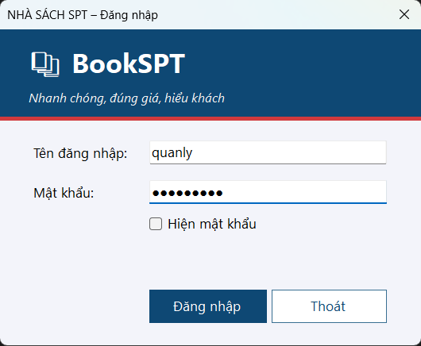
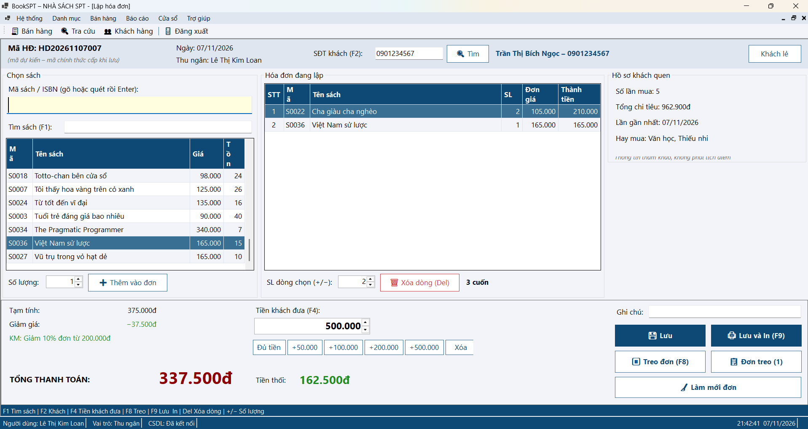
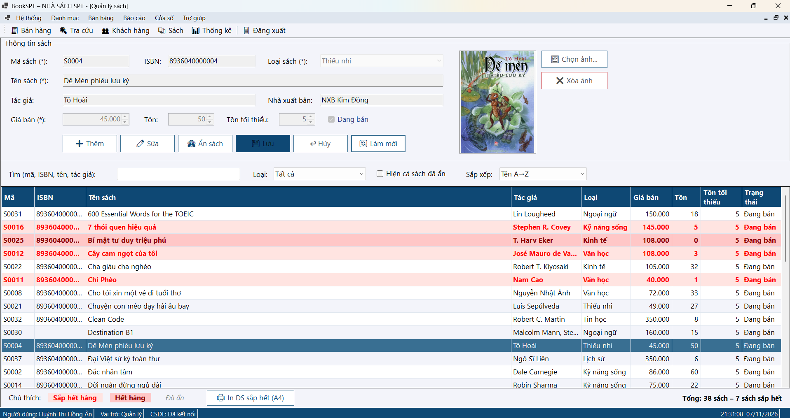
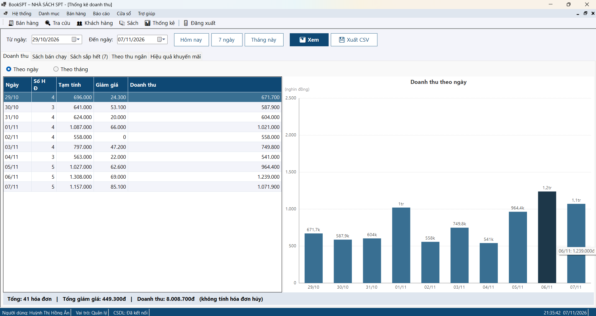

# BookSPT – Phần mềm quản lý bán sách

Đồ án học phần COMP1019 – Lập trình trên Windows.

## Thành viên nhóm

| MSSV | Họ tên | Vai trò | Nhánh |
|------|--------|---------|-------|
| 49.01.103.058 | Võ Ngọc Tuyết Nhung | A – Trưởng nhóm | `feature/khung-csdl`, `feature/he-thong`, `feature/khach-hang`, `feature/hoa-don` |
| 49.01.103.025 | Võ Nhật Song Hân | B – Thành viên 1 | `feature/danh-muc` |
| 49.01.103.045 | Lê Thị Kim Loan | C – Thành viên 2 | `feature/ban-hang` |
| 49.01.103.006 | Huỳnh Thị Hồng Ân | D – Thành viên 3 | `feature/khuyen-mai-thong-ke` |

## Mô tả đề tài

Ứng dụng WinForms hỗ trợ một nhà sách quản lý danh mục sách, bán hàng tại quầy, lập và in hóa đơn,
áp dụng khuyến mãi và xem thống kê doanh thu. Người dùng gồm: quản trị (admin), quản lý và thu ngân.

## Công nghệ sử dụng

- C# WinForms (.NET 8)
- SQL Server (ADO.NET, stored procedure `sp_LapHoaDon` dùng transaction)
- Mô hình 3 lớp: DTO – DAL – BLL – GUI (một số màn hình dùng mô hình MVP)
- GDI+ để vẽ biểu đồ và in hóa đơn
- Project kiểm thử đơn vị `QuanLyBanSach.Tests`

## Chức năng chính

- Đăng nhập, phân quyền theo vai trò, đổi mật khẩu, quản lý tài khoản
- Quản lý loại sách, sách, ảnh bìa, cảnh báo sách sắp hết
- Quản lý khách hàng
- Bán hàng master–detail, tính tiền trên form, đơn treo, phím tắt, in hóa đơn
- Lưu hóa đơn bằng transaction, tra cứu và hủy hóa đơn
- Khuyến mãi (theo tổng đơn, theo số lượng, theo loại sách)
- Thống kê, biểu đồ, bảng điều khiển, báo cáo cuối ngày

## Cấu trúc thư mục

```
Nhom10_QuanLyBanHang/
|-- SourceCode/
|   |-- QuanLyBanSach.sln
|   |-- QuanLyBanSach.DTO/       # đối tượng dữ liệu
|   |-- QuanLyBanSach.DAL/       # truy cập CSDL
|   |-- QuanLyBanSach.BLL/       # xử lý nghiệp vụ
|   |-- QuanLyBanSach.GUI/       # giao diện WinForms (Forms, Presenters, Views – mô hình MVP)
|   |-- QuanLyBanSach.Tests/     # unit test
|-- Database/
|   |-- 01_TaoCSDL.sql
|   |-- 02_NapDuLieuMau.sql
|   |-- QuanLyBanSachDB.bak
|-- Report/
|   |-- BaoCao.pdf
|   |-- BaoCao_LaTeX.zip
|-- Screenshots/                 # ảnh màn hình
|-- TestCases/
|   |-- TestCase.xlsx
|-- README.md
```

## Cài đặt database

1. Mở SQL Server Management Studio.
2. Chạy file `Database/01_TaoCSDL.sql` (tạo database `QuanLyBanSachDB`).
3. Chạy file `Database/02_NapDuLieuMau.sql` (nạp dữ liệu mẫu).
   Cách khác: trong SSMS chuột phải **Databases → Restore Database...** và chọn file `Database/QuanLyBanSachDB.bak`.
4. Nếu SQL Server của bạn không phải `.\SQLEXPRESS`, sửa connection string `QuanLyBanSachDB`
   trong `SourceCode/QuanLyBanSach.GUI/App.config`.

## Hướng dẫn chạy

1. Mở `SourceCode/QuanLyBanSach.sln` bằng Visual Studio 2022.
2. Chọn `QuanLyBanSach.GUI` làm Startup Project.
3. Build solution, rồi chạy (F5).

## Tài khoản demo

| Tên đăng nhập | Mật khẩu | Vai trò |
|---------------|----------|---------|
| admin | admin123 | Quản trị |
| quanly | quanly123 | Quản lý |
| thungan1 | thungan123 | Thu ngân |

## Hình ảnh màn hình

### Màn hình đăng nhập


### Màn hình bán hàng


### Quản lý sách


### Thống kê


## Báo cáo

- Bản PDF: `Report/BaoCao.pdf`
- Mã nguồn LaTeX: `Report/BaoCao_LaTeX.zip`
- Test case: `TestCases/TestCase.xlsx`

## Phân công công việc

| Thành viên | Phân hệ |
|------------|---------|
| Nhung (A) | Khung solution, lớp dùng chung, toàn bộ CSDL, đăng nhập, phân quyền, MDI, tài khoản, khách hàng, lưu hóa đơn bằng transaction (`sp_LapHoaDon`), tra cứu và hủy hóa đơn; quản lý repo, review và merge PR |
| Hân (B) | Loại sách (MVP), sách, ảnh bìa, sách sắp hết |
| Loan (C) | Màn hình bán hàng master–detail, tính tiền trên form, đơn treo, phím tắt, in hóa đơn (GDI+) |
| Ân (D) | Khuyến mãi (OOP), thống kê, biểu đồ GDI+, bảng điều khiển, báo cáo cuối ngày, unit test |
| Cả nhóm | Test, sửa lỗi, viết test case, cập nhật README và báo cáo phần mình |
