# BookSPT – Ứng dụng quản lý bán sách

**Đề tài 7: Quản lý bán hàng** (áp dụng cho cửa hàng sách)
Đồ án cuối kỳ học phần **COMP1019 – Lập trình trên Windows**
Nhóm 10 · Lớp học phần 2611COMP101904 · GVHD: ThS. Lê Thanh Thoại
Khoa Công nghệ Thông tin – Trường Đại học Sư phạm TP. Hồ Chí Minh

## Thành viên nhóm

| MSSV | Họ tên | Vai trò |
|------|--------|---------|
| 49.01.103.058 | Võ Ngọc Tuyết Nhung | Trưởng nhóm |
| 49.01.103.025 | Võ Nhật Song Hân | Thành viên |
| 49.01.103.045 | Lê Thị Kim Loan | Thành viên |
| 49.01.103.006 | Huỳnh Thị Hồng Ân | Thành viên |

## Mô tả đề tài

**BookSPT** là ứng dụng Windows Forms giúp một nhà sách nhỏ bán hàng tại quầy và quản lý cửa hàng. Mục tiêu là bán nhanh, đúng giá, cập nhật tồn kho chính xác, tự áp dụng khuyến mãi và theo dõi doanh thu theo ngày, theo tháng, theo thu ngân.

Hệ thống có 3 nhóm người dùng:

| Vai trò | Công việc trên hệ thống |
|---------|-------------------------|
| **Thu ngân** | Bán hàng, in hóa đơn, treo đơn, tra cứu hóa đơn và khách hàng, xem bảng điều khiển và báo cáo cuối ngày của ca mình |
| **Quản lý** | Toàn bộ việc của thu ngân; quản lý sách, loại sách, giá bán, khuyến mãi; hủy hóa đơn; xem thống kê toàn cửa hàng |
| **Admin** | Quản lý tài khoản: thêm, sửa vai trò, khóa/mở khóa, đặt lại mật khẩu (không tham gia bán hàng) |

Khách hàng không đăng nhập hệ thống. Thu ngân ghi nhận thông tin khách quen để tra cứu lịch sử mua và gợi ý mua kèm; hóa đơn không gắn khách được ghi là “Khách lẻ”.

## Công nghệ sử dụng

- **C# WinForms** – .NET 8 (`net8.0-windows`): MDI, MenuStrip, ToolStrip, StatusStrip, DataGridView, UserControl
- **SQL Server** 2022 Express – 7 bảng, 18 stored procedure, transaction khi lưu và hủy hóa đơn
- **ADO.NET** – `Microsoft.Data.SqlClient` 5.2.2, gọi stored procedure qua `SqlParameter`
- **Mô hình 3 lớp** – DTO, DAL, BLL, GUI
- **Mô hình MVP** ở tầng giao diện cho 4 màn hình: Loại sách, Khách hàng, Khuyến mãi, Đơn treo
- **GDI+, PrintDocument, PrintPreviewDialog** – biểu đồ, in hóa đơn (K80, A5), báo cáo (A4), tự sinh mã QR
- **MSTest** 3.6.1 – 32 unit test cho module khuyến mãi và các Presenter
- Visual Studio 2022, SQL Server Management Studio 20, Git/GitHub

### Cấu trúc solution (3 lớp + MVP)

```
SourceCode/
├── QuanLyBanSach.sln
├── QuanLyBanSach.DTO/       # Đối tượng dữ liệu: Sach, LoaiSach, KhachHang, HoaDon, KhuyenMai...
│   └── ThongKe/             #   DTO cho thống kê, báo cáo
├── QuanLyBanSach.DAL/       # Truy cập CSDL (ADO.NET, stored procedure)
├── QuanLyBanSach.BLL/       # Nghiệp vụ, kiểm tra dữ liệu, phân quyền
│   └── KhuyenMai/           #   IQuyTacKhuyenMai, QuyTacKhuyenMaiCoSo, 3 lớp khuyến mãi, Factory
├── QuanLyBanSach.GUI/       # Giao diện WinForms
│   ├── Forms/               #   Các Form
│   ├── Views/               #   MVP – View: ILoaiSachView, IKhachHangView, IKhuyenMaiView, IDonTreoView
│   ├── Presenters/          #   MVP – Presenter: LoaiSachPresenter, KhachHangPresenter, ...
│   ├── UserControls/        #   UcBangDieuKhien, BieuDoCot
│   ├── Printing/            #   HoaDonPrinter, BaoCaoCuoiNgayPrinter, SachSapHetPrinter, MaQR
│   └── Helpers/
└── QuanLyBanSach.Tests/     # Unit test MSTest
```

Các project tham chiếu một chiều `GUI → BLL → DAL`, cả ba dùng chung `DTO`.

Trong các màn hình MVP:
- **Model** là DTO và BLL.
- **View** là Form, chỉ cài đặt interface `I…View` và chuyển sự kiện.
- **Presenter** nhận yêu cầu từ View, gọi BLL rồi ra lệnh cho View hiển thị.

Vì Presenter không dùng control hay `MessageBox`, nó kiểm thử được bằng View giả mà không cần mở Form.

## Chức năng chính

**Hệ thống**
- Đăng nhập, đăng xuất, đổi mật khẩu; mật khẩu băm SHA-256.
- Phân quyền hai tầng: ẩn menu theo vai trò ở GUI và kiểm tra quyền trong BLL.
- Quản lý tài khoản: thêm, sửa vai trò, khóa/mở khóa, đặt lại mật khẩu.

**Danh mục**
- Quản lý loại sách (MVP); không cho xóa loại đang có sách.
- Quản lý sách: thêm, sửa, ẩn/hiện; giá bán, tồn kho, tồn tối thiểu; ảnh bìa; tìm không phân biệt dấu, lọc theo loại.
- Cảnh báo và in danh sách sách sắp hết.
- Quản lý khách hàng (MVP): thêm, sửa, xóa, tìm theo mã/tên/SĐT, xem lịch sử mua.

**Bán hàng**
- Lập hóa đơn master–detail. Gõ hoặc quét mã sách/ISBN rồi Enter; thêm lại cùng một sách thì số lượng được cộng dồn.
- Phím tắt F1, F2, F4, F8, F9, Delete, +/−; nút mệnh giá tiền khách đưa.
- Tự tính tạm tính, giảm giá, tổng tiền, tiền thối; không cho lưu khi khách đưa chưa đủ.
- Hồ sơ khách quen và gợi ý mua kèm.
- Treo hóa đơn (tối đa 5 đơn mỗi thu ngân) và gọi lại (MVP).
- Lưu hóa đơn, chi tiết và trừ tồn kho trong một transaction (`sp_LapHoaDon`).
- Xem trước và in hóa đơn khổ K80 hoặc A5, có mã QR.

**Hóa đơn**
- Tra cứu hóa đơn theo mã, khách, khoảng ngày, thu ngân, trạng thái; in lại.
- Hủy hóa đơn có ghi lý do, hoàn tồn kho trong transaction.

**Khuyến mãi** (MVP)
- 3 loại: theo tổng đơn, theo số lượng, theo loại sách.
- Hệ thống tự chọn mức có lợi nhất cho khách và nhắc “Mua thêm … để được giảm …”.

**Thống kê, báo cáo**
- Bảng điều khiển trong ngày tự cập nhật khi có hóa đơn mới; biểu đồ 7 ngày; top 5 sách bán chạy.
- Doanh thu theo ngày/tháng, theo thu ngân; sách bán chạy; hiệu quả khuyến mãi; biểu đồ GDI+; xuất CSV.
- Báo cáo cuối ngày theo thu ngân, in khổ A4.

## Cấu trúc database

**Tên database:** `QuanLyBanSachDB`

| Bảng | Nội dung |
|------|----------|
| `TaiKhoan` | Tên đăng nhập, mật khẩu (băm SHA-256), họ tên, vai trò (1 Thu ngân, 2 Quản lý, 3 Admin), trạng thái |
| `LoaiSach` | Loại sách |
| `Sach` | Mã sách, ISBN, tên, tác giả, NXB, loại, giá bán, tồn kho, tồn tối thiểu, ảnh bìa, đang bán |
| `KhachHang` | Họ tên, SĐT, email, địa chỉ |
| `KhuyenMai` | Loại khuyến mãi, điều kiện, mức giảm, thời gian hiệu lực |
| `HoaDon` | Mã hóa đơn, ngày lập, thu ngân, khách, khuyến mãi, tiền, trạng thái, lý do hủy |
| `ChiTietHoaDon` | Mã hóa đơn, mã sách, số lượng, đơn giá |

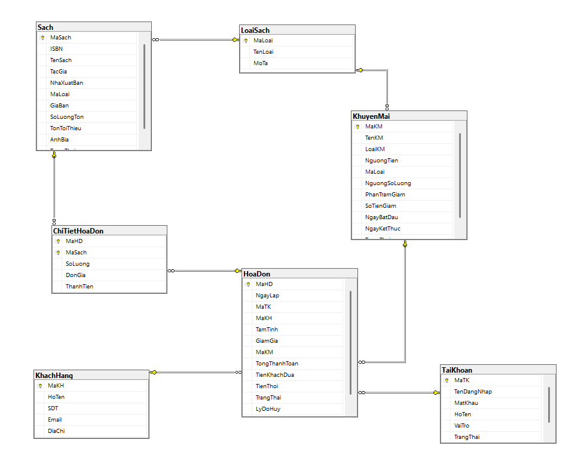

**Quan hệ:**
- `LoaiSach` 1–n `Sach`
- `TaiKhoan`, `KhachHang`, `KhuyenMai` mỗi bảng 1–n `HoaDon`
- `HoaDon` 1–n `ChiTietHoaDon` n–1 `Sach`

**18 stored procedure:**

| Nhóm | Stored procedure |
|------|------------------|
| Tài khoản | `sp_DangNhap` |
| Sách | `sp_TimSach`, `sp_LaySachTheoMaHoacISBN`, `sp_SachSapHet`, `sp_SachMuaKem` |
| Hóa đơn | `sp_TaoMaHoaDon`, `sp_LapHoaDon`, `sp_HuyHoaDon`, `sp_TraCuuHoaDon`, `sp_LayChiTietHoaDon` |
| Khuyến mãi | `sp_KhuyenMaiHieuLuc`, `sp_HieuQuaKhuyenMai` |
| Thống kê | `sp_DoanhThuTheoNgay`, `sp_DoanhThuTheoThang`, `sp_DoanhThuTheoThuNgan`, `sp_SachBanChay`, `sp_TongQuanTrongNgay`, `sp_BaoCaoCuoiNgay` |

`sp_LapHoaDon` nhận chi tiết hóa đơn qua kiểu bảng `ChiTietHoaDonType`, sau đó lưu hóa đơn, chi tiết và trừ tồn kho trong một transaction; có lỗi thì `ROLLBACK`.

**File trong thư mục `Database/`:**

| File | Nội dung |
|------|----------|
| `01_TaoCSDL.sql` | Tạo lại database, 7 bảng, ràng buộc, index, kiểu bảng, 18 stored procedure (chạy lại nhiều lần được) |
| `02_NapDuLieuMau.sql` | Dữ liệu mẫu: 5 tài khoản (1 tài khoản bị khóa), 9 loại sách, 40 sách, 15 khách hàng, 5 khuyến mãi, 60 hóa đơn trong 14 ngày gần nhất |
| `QuanLyBanSachDB.bak` | Bản sao lưu database (SQL Server 2022) |

## Hướng dẫn cài đặt

**Yêu cầu:**
- Windows 10/11
- Visual Studio 2022 (17.8 trở lên, có workload *.NET desktop development*)
- .NET 8 SDK
- SQL Server 2022 Express
- SSMS 20

**1. Tải mã nguồn**

```bash
git clone https://github.com/TuyetNhung19/Nhom10_QuanLyBanHang.git
```

**2. Tạo database:** mở SSMS, kết nối SQL Server rồi lần lượt mở và chạy (F5):
1. `Database/01_TaoCSDL.sql`
2. `Database/02_NapDuLieuMau.sql`

Hoặc restore từ backup: chuột phải **Databases → Restore Database…**, chọn `Database/QuanLyBanSachDB.bak`.

**3. Sửa connection string** trong `SourceCode/QuanLyBanSach.GUI/App.config` nếu cần:

```xml
<add name="QuanLyBanSachDB"
     connectionString="Server=.\SQLEXPRESS;Database=QuanLyBanSachDB;Trusted_Connection=True;TrustServerCertificate=True"
     providerName="Microsoft.Data.SqlClient" />
```

Chỉ cần đổi phần `Server=` cho đúng máy:

| Kiểu cài đặt SQL Server | Giá trị `Server=` |
|---|---|
| SQL Server Express | `Server=.\SQLEXPRESS` |
| Instance mặc định (Developer/Standard) | `Server=.` |
| LocalDB | `Server=(localdb)\MSSQLLocalDB` |
| Instance có tên khác | `Server=TÊN-MÁY\TÊN-INSTANCE` |

**4. Mở và chạy chương trình**
1. Mở `SourceCode/QuanLyBanSach.sln` bằng Visual Studio 2022.
2. Chuột phải `QuanLyBanSach.GUI` → **Set as Startup Project**.
3. Vào **Build → Rebuild Solution** (các gói NuGet được tự khôi phục), rồi nhấn **Ctrl+F5**.

**5. Chạy unit test (không bắt buộc):** vào **Test → Run All Tests**. 32 test chạy không cần database.

Nếu chương trình báo không kết nối được database, kiểm tra:
- dịch vụ SQL Server đã được bật (`services.msc`);
- giá trị `Server=` trong connection string;
- đã chạy đủ hai script.

## Tài khoản demo

| Tên đăng nhập | Mật khẩu | Vai trò | Trạng thái |
|---------------|----------|---------|------------|
| `admin` | `admin123` | Admin | Hoạt động |
| `quanly` | `quanly123` | Quản lý | Hoạt động |
| `thungan1` | `thungan123` | Thu ngân | Hoạt động |
| `thungan2` | `thungan123` | Thu ngân | Hoạt động |
| `thungan3` | `thungan123` | Thu ngân | **Bị khóa** |

> `thungan3` dùng để kiểm tra trường hợp tài khoản bị khóa: đăng nhập đúng mật khẩu nhưng hệ thống vẫn từ chối và báo tài khoản đã bị khóa. Admin có thể mở khóa trong màn hình Quản lý tài khoản.

## Hình ảnh màn hình

### Đăng nhập


### Màn hình chính
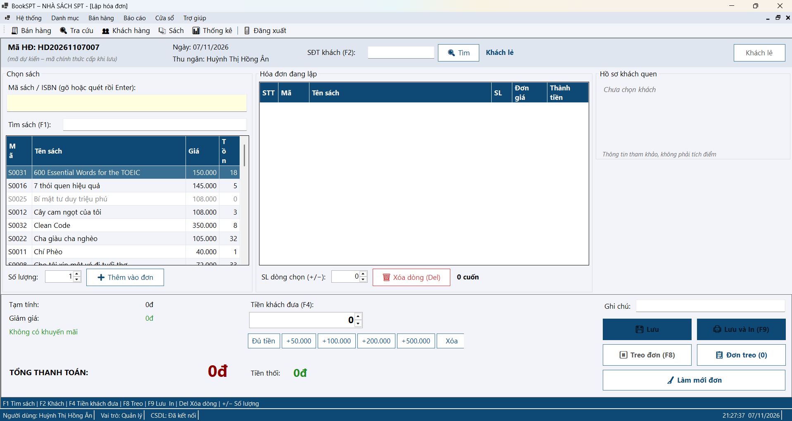

### Bảng điều khiển trong ngày
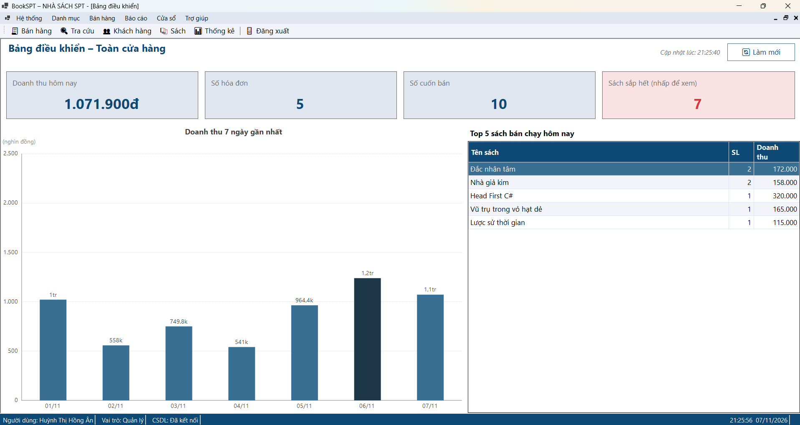

### Quản lý sách


### Quản lý khách hàng
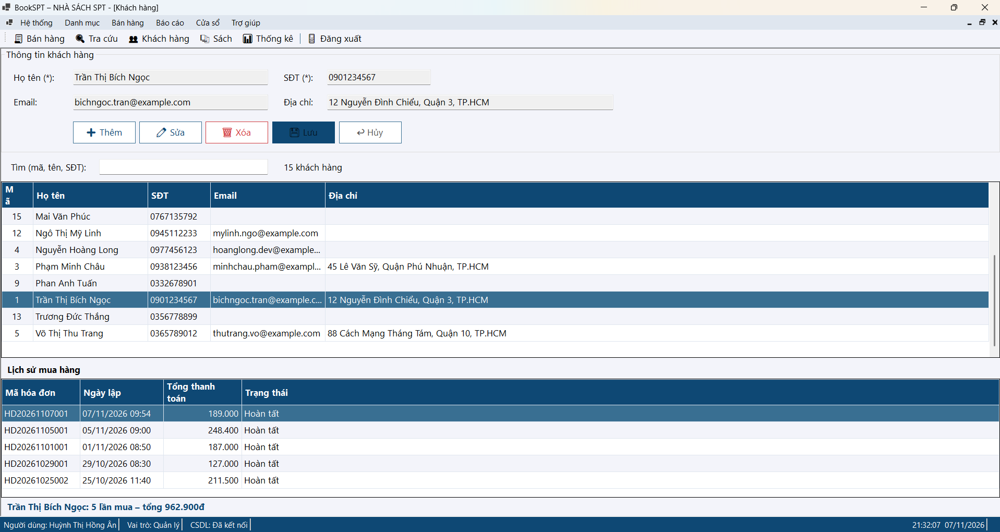

### Kiểm tra dữ liệu nhập (ErrorProvider)
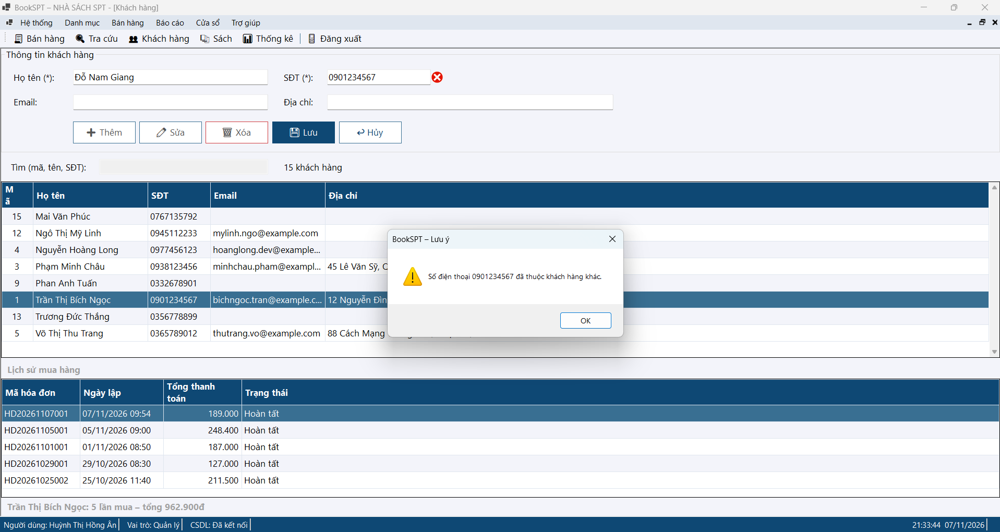

### Quản lý khuyến mãi
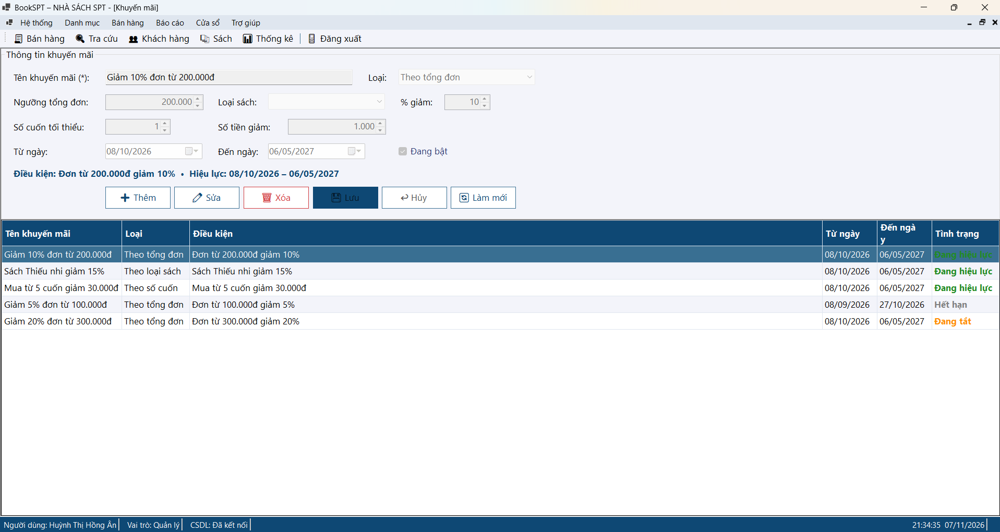

### Bán hàng


### Nhắc mua thêm để được khuyến mãi
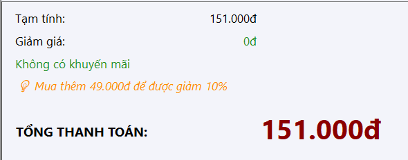

### Danh sách đơn treo
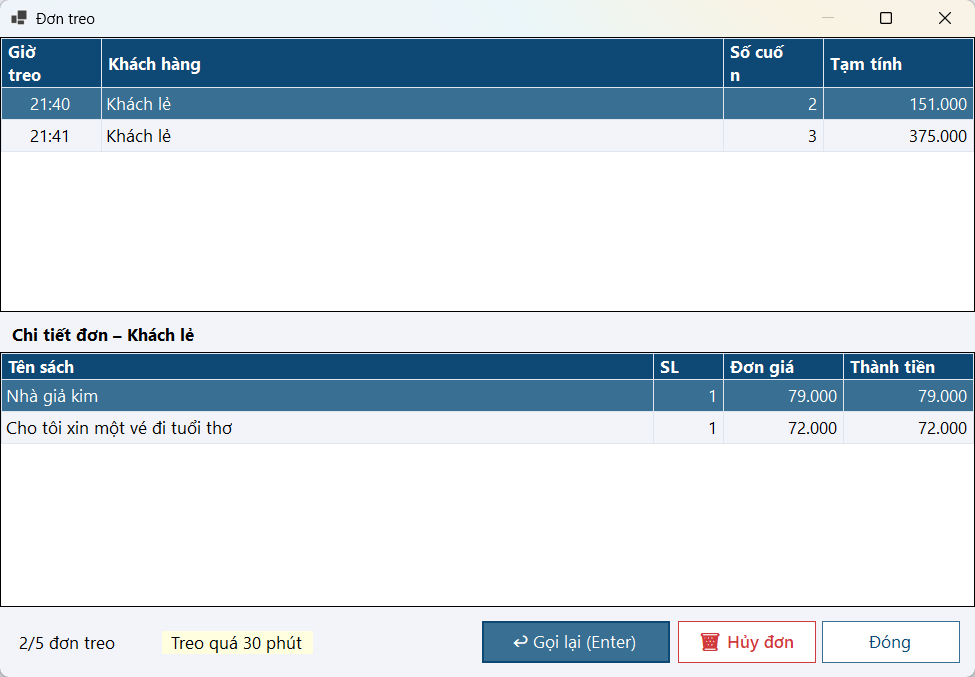

### In hóa đơn
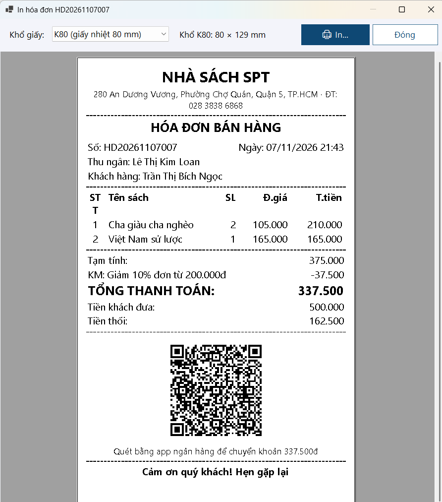

### Tra cứu hóa đơn
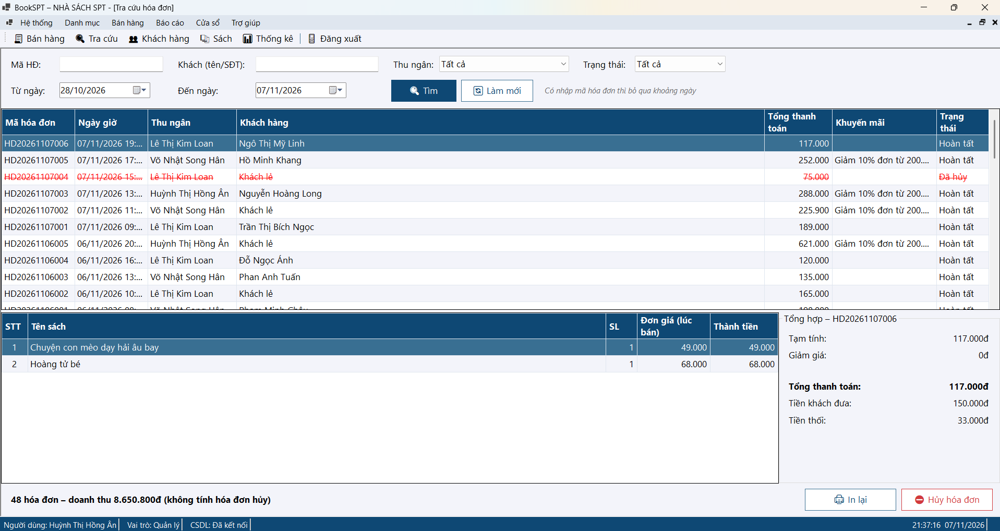

### Thống kê


### Báo cáo cuối ngày
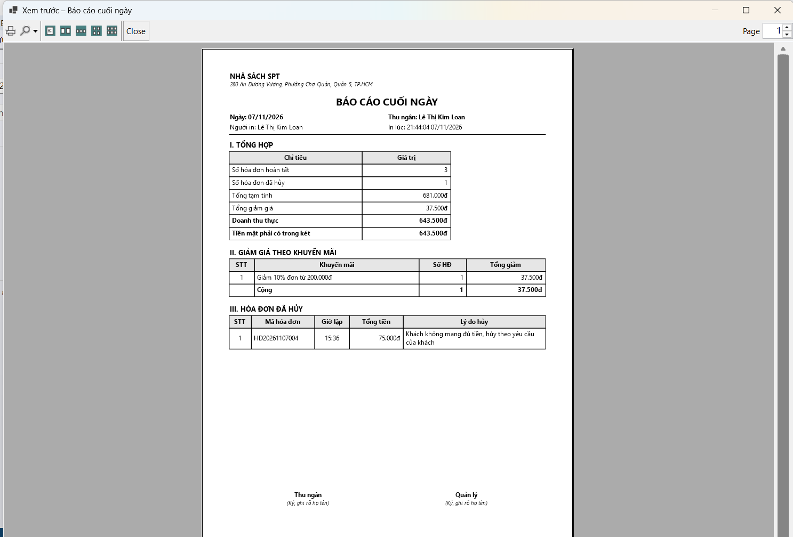

### Quản lý tài khoản
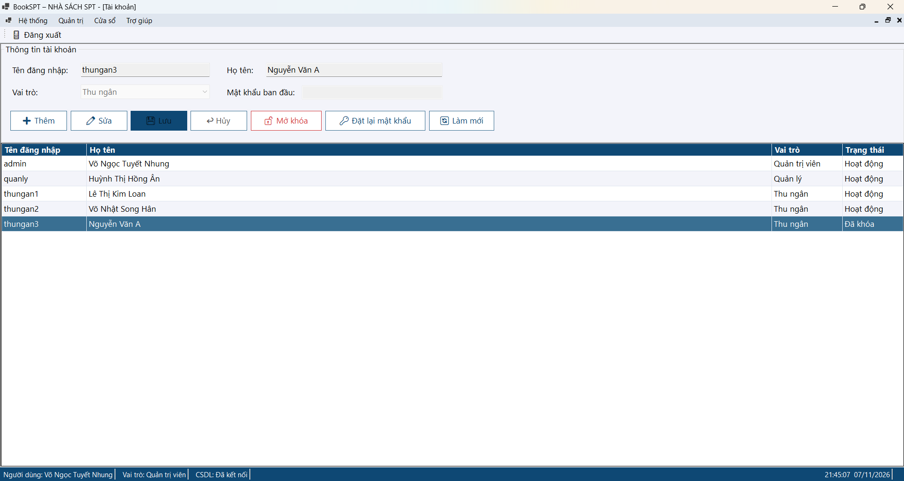

### Kết quả unit test (Test Explorer)
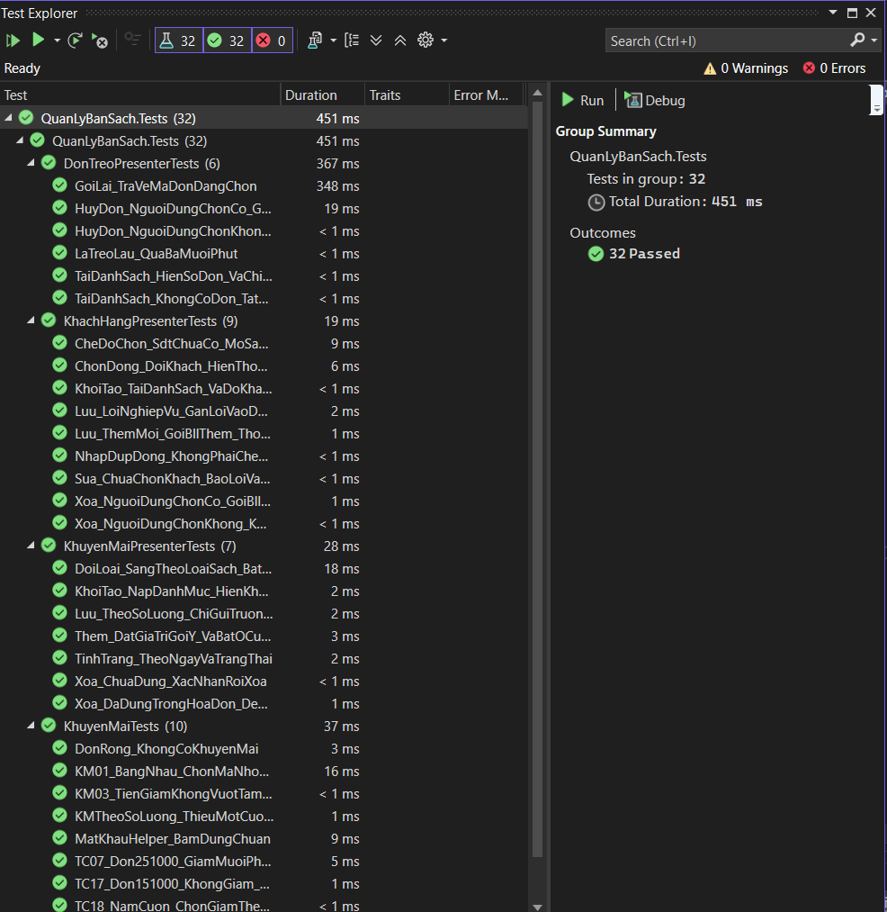

## Phân công công việc

| Họ và tên | MSSV | Công việc phụ trách |
|-----------|------|---------------------|
| **Võ Ngọc Tuyết Nhung**<br>(Trưởng nhóm) | 49.01.103.058 | **Viết code:** khung chương trình, CSDL, đăng nhập, phân quyền, tài khoản, khách hàng, lưu – tra cứu – hủy hóa đơn.<br>**Viết báo cáo:** phân quyền, CSDL, kiến trúc, các chức năng đã code, kết luận; biên tập.<br>**Khác:** test case, kiểm thử, slide, thuyết trình.<br>**Branch:** `feature/khung-csdl`, `feature/he-thong`, `feature/khach-hang`, `feature/hoa-don`, `feature/database-backup` |
| **Huỳnh Thị Hồng Ân** | 49.01.103.006 | **Viết code:** khuyến mãi, thống kê, biểu đồ, báo cáo cuối ngày, unit test.<br>**Viết báo cáo:** các chức năng đã code, kiểm thử.<br>**Branch:** `feature/khuyen-mai-thong-ke` |
| **Lê Thị Kim Loan** | 49.01.103.045 | **Viết code:** bán hàng, đơn treo, phím tắt, in hóa đơn.<br>**Viết báo cáo:** giới thiệu, giao diện, các chức năng đã code, cài đặt.<br>**Branch:** `feature/ban-hang` |
| **Võ Nhật Song Hân** | 49.01.103.025 | **Viết code:** loại sách, sách, sách sắp hết.<br>**Viết báo cáo:** lời cảm ơn, phạm vi, các chức năng đã code, hạn chế, tài liệu tham khảo, phụ lục.<br>**Branch:** `feature/danh-muc` |

Mỗi thành viên làm trên branch riêng và gộp vào `main` qua Pull Request; trưởng nhóm review và merge. Lịch sử đóng góp xem tại **Insights → Contributors** và **Commits** của repository.